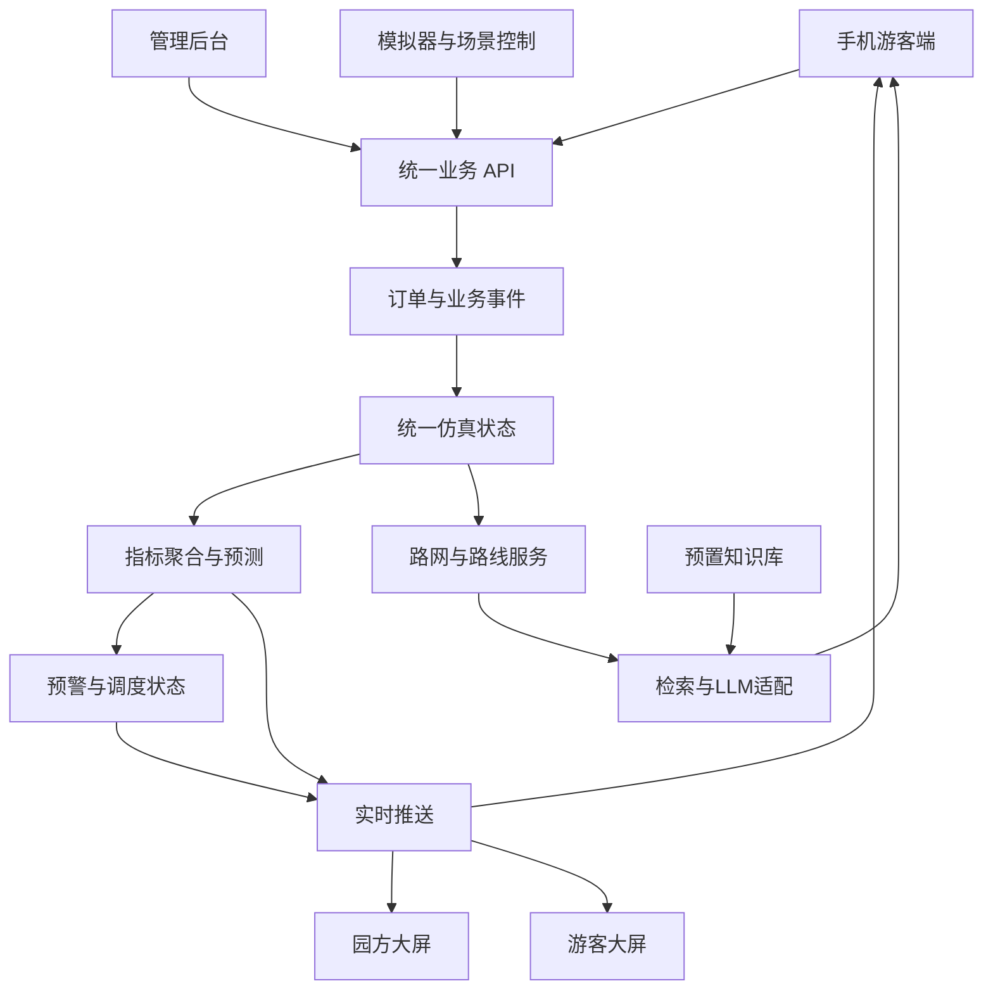

# 智慧景区演示系统设计方案

> 版本：V1.0  
> 用途：技能竞赛，约 10 分钟主线演示，支持自由体验。  
> 交付物：`智慧景区演示系统设计方案.md`。  
> 本轮完成需求与设计，不实施业务代码。

## 一、项目定位与设计目标

建设一套围绕同一虚构文化景区运行的演示系统，涵盖游客服务、园方运营、公共导览与实时数据仿真。

核心展示闭环：

**预约 → 停车及入园核销 → 游客在景区内活动 → 客流及设施负载变化 → AI 路线推荐与公共引导 → 园方调度 → 数据反馈。**

运营数据使用 Mock，但业务操作、跨端通信、预约库存、扫码识别、聊天以及 LLM 调用真实运行。模拟数据必须遵守人数、车辆、容量和时间约束。

成功标准：

- 手机操作能够影响后台及大屏，跨端展示口径一致。
- 仿真能够体现到达高峰、游览移动、停留、排队、离园等行为。
- AI 路线具有路网与时间依据，知识问答具有内容来源。
- 演示能够重置、重复执行、主动触发关键场景。
- 游客信息与园方内部运营信息通过权限和接口隔离。

## 二、系统组成与现有项目改造

### 2.1 四个独立入口

四个入口拥有独立页面、导航和访问规则，共用后端，不依赖屏幕尺寸决定进入哪个产品。

| 入口 | 使用对象 | 核心功能 |
|---|---|---|
| `/m` | 手机游客 | 资讯、预约、凭证、二维地图、扫码、AI、聊天、个人中心 |
| `/screen/ops` | 园方 | 三维沙盘、运营指标、预警、处置状态 |
| `/screen/visitor` | 游客公共触控屏 | 三维导览、景点忙闲、厕所与停车查询、公共公告 |
| `/admin` | 工作人员 | 内容、预约、核销、设施、用户、聊天、预警及仿真管理 |

游客手机可以直接访问；大屏二维码用于将选中的景点或公共导览内容交接到手机。

### 2.2 复用与重构边界

现有项目：`/Users/aiden/Documents/ChatGPT/miniprogram`。

| 模块 | 当前基础 | 本轮设计 |
|---|---|---|
| 游客端 | 原生微信小程序 | 重做 H5；保留原生代码，本轮不要求同步新增能力 |
| 预约订单 | 免费预约、库存、取消、改期、二维码核销 | 复用业务基础，统一规则，增加与仿真世界的联动 |
| 管理后台 | 内容、预约、库存、核销、角色、人流管理 | 扩展并拆分页面，增加设施、聊天、预警和仿真管理 |
| 客流 | 景点估算、观测、统计预测 | 当前状态改由统一仿真产生，预测作为独立结果 |
| 路线推荐 | 贪心及 2-opt 等算法 | 引入真实景区路网约束，结合实时状态和 LLM |
| 人工讲解预约 | 已有独立预约类型 | 游客入口改成 AI 讲解，旧记录保留 |
| 大屏 | 单文件 HTML 原型 | 保留有用指标，重做为两套三维沙盘页面 |

原型参考：`/Users/aiden/Downloads/智慧景区数据大屏 Demo v2.html`。

改造前复核已有评审指出的订单改期、客户端幂等重试、批量库存修改和旧接口规则问题，不能直接将旧实现视为已满足新方案。

### 2.3 技术方案

- 游客 H5、管理后台和两套大屏：Vue 3、TypeScript、Vite，共享基础组件及接口类型。
- 三维沙盘：Three.js，采用风格化低多边形地形、建筑和设施。
- 手机地图：二维 SVG 地图，共用三维场景的点位及路网坐标。
- 统计图表：ECharts。
- 后端：保留 Node.js 24 与现有领域分层，按业务模块扩展。
- 数据库：沿用 SQLite，适用于本次单实例演示；不进行多实例并发写入。
- 实时通信：WebSocket，支持聊天、状态更新及场景广播。
- 二维码：复用后端生成能力；浏览器摄像头配合二维码识别库完成扫码。
- LLM：后端统一适配模型接口，密钥仅保存在服务端。
- 知识检索：预置内容、分段与向量索引随演示包发布；索引记录对应嵌入模型及版本。

## 三、游客业务设计

### 3.1 手机信息架构

底部导航采用五项：**首页、导览、预约、聊天室、我的**。

首页聚合景区公告、资讯、预约入口、设施状态与 AI 服务。地图内提供扫码、附近厕所、停车场、景点详情和路线入口。

允许未登录浏览资讯、介绍和公共地图。预约、发送聊天消息、保存个人路线时登录。采用预置演示账号并支持简易注册，不接微信登录、真实短信或实名验证。

### 3.2 免费入园预约与核销

- 选择日期、时段、人数，填写联系人和联系电话。
- 沿用人数制预约，本轮不建立实名同行人档案。
- 展示可预约余量、入园时间及取消规则。
- 创建成功即确认，无支付环节。
- 支持订单查看、取消、改期和二维码凭证。
- 新建、取消和改期共用预约规则；库存修改不得低于有效预约数量。
- 默认按订单整组核销，不做部分人员分批核销。
- 核销必须由工作人员入口执行，游客不能自行将订单改为已核销。
- 首次核销生成对应人数的入园事件；重复核销不重复增加人数。
- 演示人员可在控制台触发离园；模拟游客依据行为规则离园。

核销消耗的是已预约资格，不能因核销完成就释放原时段预约配额。

### 3.3 停车预约

沿用原项目的**独立分时预约**：填写车牌、车型，单笔预约按一辆车计算，不强制关联入园订单，不选择具体车位。

增加停车场选择与进出场状态：

- 预约：记录停车场、到达时段和车辆信息，占用该时段预约配额。
- 到场核销：产生车辆进场事件，增加实际占用车位。
- 出场：释放实际车位。
- 取消或未到超时：按规则释放预约配额，不改变实际占用。
- 默认超过到达时段结束 30 分钟仍未核销，预约失效；宽限时间后台可配置。

**预约余量与实际空位分别展示。** 本轮分时预约不承诺指定车位；若到场时停车场已满，进入等待或由游客确认改选备用停车场，不允许实际占用超过容量。

停车核销不等同于人员入园；同行人数由入园订单独立统计。

### 3.4 地图、位置与二维码

手机展示二维景区地图，支持点位详情、路网、路线、热度及设施图层。

景点和文物使用静态介绍码，预约订单使用独立核销凭证，两种二维码的用途和权限分开。

- 扫描景点码：打开介绍，并将演示中的景区位置设置到该点。
- 扫描文物码：打开文物介绍，位置归属对应展馆。
- 选择路线后：支持开始、暂停、继续沿路网模拟移动。
- 演示控制区：允许切换起点；位置迁移同步调整相关区域人数。
- 页面明确标识“演示位置”，不冒充 GPS 定位。
- 摄像头不可用时提供图片识别和演示码选择入口，保证流程可继续。
- 介绍页面可收藏，并携带当前景点或文物上下文进入 AI 问答。

已核销的演示订单与移动中的游客组绑定，组内人数整体移动；未入园的地图预览不改变在园人数。

### 3.5 AI 路线与知识问答

路线使用**偏好表单一键生成**，默认提供：

- 游玩时长：1、2、3、4 小时。
- 兴趣：自然、古建、文物、摄影、亲子。
- 节奏：轻松、标准、紧凑。
- 同行条件：老人、儿童、无障碍需求。
- 必去景点及避拥堵偏好。

处理流程：

1. 后端读取偏好、当前位置、开放状态和当前客流。
2. 在路网上计算满足时间与通行约束的候选路线。
3. 将候选路线及已知事实交给 LLM 生成推荐理由。
4. 校验输出点位与路线引用，向游客返回路线和说明。

路线展示预计总时长、步行距离、各站停留与等待时间、拥堵等级及推荐理由。不宣称保证全局最优。

拥堵或道路关闭后提示重新规划，由游客点击生成新路线，不静默替换正在使用的路线。无可行路线时说明原因，并提示缩短必去清单或延长时间。

知识问答采用预置知识库：

- 统一维护景点、文物、背景知识和参考来源。
- 虚构景区设定与真实历史知识明确区分，虚构文物不包装成真实出土记录。
- 按当前点位和问题检索内容，再由模型组织回答。
- 回答附可展开的来源条目。
- 缺乏依据时明确表示知识库暂无相关内容。
- 当前排队、开放状态等动态信息读取业务接口，不使用静态知识库代答。
- 后台查看知识内容、版本及索引状态，本轮不做文档上传和在线索引编辑。

### 3.6 游客聊天室

提供全园聊天室和分景点聊天室：

- 登录游客可切换房间、发送文字及表情。
- 各房间支持近期历史记录、实时消息、系统公告。
- 支持举报、后台撤回、禁言及基础发送频率限制。
- 模拟游客按游览行为发送相关消息，明确标识模拟身份。
- 用户消息作为聊天内容处理，不执行其中夹带的系统指令。
- 本轮不做私聊、图片上传或全屏展示游客聊天记录。

## 四、双大屏与后台设计

### 4.1 三维沙盘基础

两套大屏共享同一景区模型，采用不同的信息图层和交互配置。

默认景区规模：

- 8 个景点，覆盖自然、古建、文化展馆和活动广场。
- 12 件文物或展品，归属展馆及具体展示点。
- 2 个出入口、3 个停车场，其中 1 个可设为备用场。
- 6 座厕所，包含男女厕、无障碍设施及维修状态。
- 连通道路包含主路、支路、桥梁和无障碍绕行路径。

模型与导航使用统一坐标、点位 ID 和道路关系。建筑装饰不能改变真实可通行路网。

沙盘支持缩放、旋转、复位、点位选中及图层切换。场景资源本地随包发布，避免依赖外部地图服务。

### 4.2 园方运营大屏

三维沙盘占主要展示面积，外围指标围绕运营判断组织。

| 信息 | 展示方式与口径 |
|---|---|
| 今日累计入园 | 数值卡；按成功入园事件人数累计 |
| 实时在园 | 数值卡及承载条；入园减离园 |
| 今日有效预约人数 | 数值卡；按游览日期统计，排除取消和失效 |
| 到期预约核销率 | 已核销人数 ÷ 截至当前应到且有效的预约人数 |
| 客流趋势 | 入离园分时柱图；在园人数与未来预测单独折线展示 |
| 预测对比 | 同时点实际与预测曲线，标注偏差 |
| 区域客流 | 沙盘区域着色、点位详情与密度排名 |
| 停车 | 各场占用、空闲、停用车位的堆叠条形图 |
| 厕所 | 空闲厕位、排队人数、预计等待时间列表 |
| 环境 | 温度、湿度、风、AQI、负氧离子数值及短趋势 |
| 预警 | 严重级别、位置、持续时间、责任状态及处置结果 |
| 公告 | 内部调度信息与公开公告分开展示 |

取消原型中的营收、门票销量、满意度及“预测达成率决定爆满”的逻辑。

累计入园可高于园区瞬时容量；拥堵依据当前在园及区域状态判断。预测值不参与伪造实际历史。

大屏提供预警定位和详情；状态修改统一进入管理后台相应页面，避免形成两套调度逻辑。

### 4.3 游客公共触控屏

游客屏突出“现在去哪、哪里方便、哪里暂时不能去”。

- 三维景区导览、当前位置“本屏所在点”。
- 景点介绍、开放时间与当前忙闲程度。
- 厕所位置、无障碍设施和预计等待。
- 停车场剩余车位、出入口及公共服务位置。
- 公共游览路线、预计耗时及绕行提示。
- 天气、闭园提醒、活动信息和公开公告。
- 选中内容生成二维码，在手机独立入口继续查看。

不展示内部预警记录、订单、联系人、员工信息或运营审计。

公共屏不登录个人账号，不提交个人预约或聊天消息。默认闲置 60 秒回到首页并清除上一次查询状态。

### 4.4 管理后台

保留管理员、内容编辑、运营角色，增加只读园方大屏访问权限。

管理模块：

- 景区资料、资讯、指南、公告、景点及文物介绍。
- 预约项目、时段、容量、订单、取消、改期与核销。
- 停车场、厕所、道路和景点开放状态。
- 用户、角色、聊天房间、举报、撤回与禁言。
- 预警确认、调度操作和处置记录。
- 知识库条目及索引状态查看。
- 模拟运行、暂停、倍速、场景触发和重置。
- 操作审计及服务运行状态。

预警闭环采用：

**触发 → 待确认 → 已确认／处理中 → 条件恢复 → 已恢复。**

人工确认不等同于问题消失。调度后，游客逐步响应；条件持续恢复后系统自动解除。人工关闭但触发条件仍存在时，允许再次产生预警。

## 五、统一 Mock 世界与指标口径

### 5.1 仿真原则

模拟器维护游客、车辆、区域、道路及设施状态，各页面不得自行随机生成人数。

默认使用景区营业时段 08:00—18:00，演示从 09:30 初始化。仿真时钟支持暂停和 1、5、15 倍速，主线默认 5 倍速。

预约期限、游客移动、排队和业务统计使用仿真时钟；登录有效期、网络超时和限流使用真实时钟。

固定种子和相同操作日志支持重放。真实 LLM 输出单独记录，不承诺外部模型重复生成相同文字。

### 5.2 游客与车辆行为

游客按组模拟，包含人数、兴趣、速度、停留偏好、到离园计划和交通方式。

主要状态：

**计划到达 → 等待入园 → 在道路上移动 → 景点停留／设施排队 → 离园。**

行为受到以下因素共同影响：

- 日内到达曲线、周末及节假日系数。
- 景点吸引力、距离、开放时间和当前排队。
- 团队到达造成的短时集中客流。
- 午间活动、厕所需求与游览时长。
- 天气变化、公共公告和园方调度。

车辆独立维护未到、等待、在场、离场状态。游客步行入园不产生车辆；车辆进场不自动增加在园游客。

模拟游客与现场体验游客采用不同来源标签，但遵循同一业务约束。模拟预约和入离园通过业务服务产生，不绕过业务规则直接改计数。

### 5.3 数据约束

- 在园人数＝累计入园人数－累计离园人数。
- 各互斥区域人数之和＝在园人数；道路和设施等待区也计入区域。
- 热度图层和厕所使用者统计可能重叠，不再次累加为在园人数。
- 密度＝区域人数÷有效可活动面积。
- 饱和度＝区域人数÷区域配置承载量。
- 停车场容量＝占用＋空闲＋停用。
- 厕所总厕位＝使用中＋空闲＋停用。
- 预约配额与实际设施占用分别维护。
- 人数、车位、厕位和排队人数不得为负。
- 预约成功、核销、退订、出场等操作保持幂等。

### 5.4 厕所与环境模拟

厕所按男女厕和无障碍服务类型维护可用设施、排队和使用时长。等待时间根据对应服务类型的队列及近期处理速度估算，不能仅用占用百分比换算。

附近厕所推荐综合步行时间、预计等待、开放状态和无障碍需求。数据不足时展示“暂无法估算”。

天气和环境使用缓慢变化的背景过程，可触发降雨剧情。环境指标与人员状态分开建模，不强行将所有数值与客流绑定。

### 5.5 场景与预警

预置五类剧情：

1. 团队游客到达，引发入口短时排队。
2. 热门展馆集中到访，引发局部拥堵。
3. 主停车场接近满位，园方开放备用场。
4. 厕所部分厕位维修，引发排队和引导。
5. 降雨导致室外游览偏好下降，游客向室内转移。

触发剧情改变到达计划、偏好或设施条件，不直接将最终指标跳到指定值。

默认演示预警：

- 区域饱和度达到 80% 持续 2 分钟预警，达到 95% 持续 1 分钟升级。
- 停车占用达到可用容量的 90% 持续 2 分钟预警。
- 厕所预计等待超过 8 分钟持续 2 分钟预警。
- 恢复阈值低于触发阈值，并持续 2 分钟后解除，避免反复闪烁。

以上为可配置的演示参数，不标注为行业安全标准。

## 六、中间层、接口与一致性

### 6.1 数据流

### 6.2 中间层职责

| 层 | 职责 |
|---|---|
| 业务服务 | 认证、预约、核销、设施操作、聊天及权限校验 |
| 事件层 | 记录有效业务动作，提供事件编号和消费去重 |
| 仿真层 | 更新游客移动、车辆占用、设施队列和模拟时间 |
| 聚合层 | 生成当前快照、时间桶统计和跨端指标 |
| 预测层 | 根据历史模拟观测与当前状态估计未来趋势 |
| 预警层 | 阈值持续判定、恢复判定及处置关联 |
| AI 层 | 路线约束、知识检索、模型调用及输出验证 |
| 推送层 | 订阅、权限过滤、断线恢复和版本管理 |

采用模块化单体后端和持久化事件表，本轮不引入 Kafka、微服务集群或分布式事务。

### 6.3 主要接口范围

保留现有 `/api/v1` 风格，统一订单入口，新增以下接口组：

- 公共：景区资料、点位、路网、设施、公告及游客屏快照。
- 游客：认证、预约订单、个人凭证、演示位置与路线会话。
- AI：路线生成、知识问答及来源查询。
- 聊天：房间、历史消息、发送、举报。
- 园方：运营快照、历史指标、预警与处置。
- 管理：设施状态、内容、库存、用户和审核。
- 仿真：运行状态、暂停、倍速、剧情、重置。

公开接口直接返回筛选后的字段；不能依靠前端隐藏敏感数据。

### 6.4 同步与状态恢复

- 仿真内部默认每真实秒推进一次，前端通过插值平滑显示移动。
- 指标快照每 2 秒推送；订单与聊天操作完成后立即通知。
- 每份状态携带运行编号、递增序号、仿真时间和生成时间。
- 客户端忽略旧序号；断线重连后重新获取完整快照。
- 超过 10 秒未收到更新，显示连接异常及最后更新时间。
- 业务写入和事件记录在同一事务内完成，事件处理支持重试去重。
- 重置生成新运行编号并清除本次演示订单、消息和游客状态，保留基础配置、演示账号及知识库。
- 旧运行二维码和会话明确提示失效，不允许影响新场景。

## 七、部署与现场演示

### 7.1 云端与备用环境

云端为主环境，提供 HTTPS、WebSocket 和服务端模型访问。现场电脑保留相同版本程序、预置资源、知识库及初始化场景。

两套环境独立运行，不做订单和聊天记录双向同步。故障切换时，从同一预置场景重新开始，全部终端切换到备用入口。

现场准备：

- 主、备入口二维码及各自匹配的景点演示码。
- 电脑浏览器分别打开两个大屏和后台。
- 手机访问独立游客入口。
- 为备用环境配置手机信任的 HTTPS 访问方式，并提前验证摄像头。
- 为游客公共屏配置其所在点位。
- 将三维模型、图标、字体和前端依赖随部署包发布。
- 演示前检查模型接口、二维码、实时连接和场景重置。

外网中断时，现场预约、地图、聊天和仿真继续运行。知识问答明确提示 AI 暂不可用；路线仍可展示算法计算结果，并标注缺少 AI 说明。

### 7.2 十分钟主线

| 时间 | 操作 | 可见结果 |
|---|---|---|
| 0:00—1:00 | 展示双大屏及当前场景 | 同一景区在两种视角下呈现不同信息 |
| 1:00—2:30 | 手机登录，免费入园及停车预约 | 后台订单、预约余量更新 |
| 2:30—3:30 | 工作人员核销停车与入园凭证 | 车辆占用、累计入园和实时在园变化 |
| 3:30—4:30 | 填写偏好生成路线 | 手机展示可行路线及 AI 推荐说明 |
| 4:30—5:30 | 扫景点或文物码，提出知识问题 | 介绍、位置与带来源回答形成连贯体验 |
| 5:30—6:30 | 开始移动，发送景点聊天消息 | 地图位置变化，另一账号实时收到消息 |
| 6:30—8:30 | 触发热门景点集中到访并处置 | 园方收到预警，游客看到公开引导，客流逐步变化 |
| 8:30—9:30 | 公共屏查询厕所并扫码交接 | 手机进入对应设施介绍与位置 |
| 9:30—10:00 | 展示恢复状态及重置能力 | 预警解除，系统回到可重复演示状态 |

停车备用场、厕所维修和降雨作为扩展剧情，不强行塞进同一次主线。

AI 请求期间保留加载状态，可继续讲解其他界面；演示事件以操作者触发为准，避免依赖固定秒数完成模型响应。

## 八、实施阶段、验收与默认边界

### 8.1 实施顺序

1. **统一设计资产**：景区设定、点位、路网、设施容量、知识内容和指标字典。
2. **建立业务基础**：复核原预约规则，完成 H5 登录、预约、核销及事件联动。
3. **完成仿真闭环**：游客、车辆、厕所、时钟、聚合、预警和重置。
4. **完成双大屏**：三维沙盘、园方图层、游客触控和公共接口。
5. **接入智慧服务**：路线约束、真实 LLM、知识检索及聊天室。
6. **联调与排练**：云端、备用环境、手机扫码、主线及异常恢复。

开发期限和团队人数尚未提供，因此采用依赖顺序安排，不承诺未经评估的工期。

### 8.2 核心验收

| 类别 | 必须通过的场景 |
|---|---|
| 预约 | 并发抢最后名额不超额；请求超时重试不重复建单；取消和改期库存正确 |
| 核销 | 无效、过期和重复凭证均有明确结果；重复操作不重复增加人车数量 |
| 数据守恒 | 连续仿真期间人数、区域、车位和厕位满足约束 |
| 停车 | 预约成功不增加实际占用；进场增加、出场释放；满场不得超容量 |
| 路线 | 路网断开、道路关闭、时间不足、无障碍要求和必去点冲突均得到正确处理 |
| 知识问答 | 有依据的问题可查来源；无依据问题不编造；模型失败有真实状态 |
| 实时同步 | 正常连接下订单和设施变化在 3 秒内反映到相应终端 |
| 聊天 | 两账号跨设备实时通信；房间隔离、撤回、禁言和重连生效 |
| 权限 | 公共大屏无法访问内部预警、订单及联系人数据 |
| 仿真重放 | 固定种子加相同操作日志得到一致状态变化；外部模型响应不作为确定性判据 |
| 场景处置 | 确认预警不改变客流；实际调度引发渐进变化，恢复后解除 |
| 环境切换 | 全部终端可切换至备用环境，旧运行数据与新场景隔离 |

默认负载验收基线为 3,000 名模拟在园游客、20 个真实浏览器连接、双大屏持续运行 30 分钟。三维大屏在最终演示电脑上目标达到 30 FPS；达不到时先降低模型和特效复杂度。

### 8.3 本轮明确边界

- 单个虚构景区，不做多景区集团或多租户平台。
- 免费入园，不接真实支付、实名验证、微信 API 或真实闸机。
- 手机二维地图，两块大屏三维沙盘，四个独立访问入口。
- 停车独立分时预约，不做具体车位选择。
- AI 路线为偏好表单一键生成，不做路线对话编辑。
- 知识库预置，不做后台文件上传及在线建库。
- 聊天支持全园和分景点房间，不做私聊。
- 不增加营收、门票售卖、满意度评价业务。
- 云端与现场备用不同步运行数据。
- 景区名称、模型细节和数值参数为可替换配置；业务口径及跨端联动必须遵守本方案。
