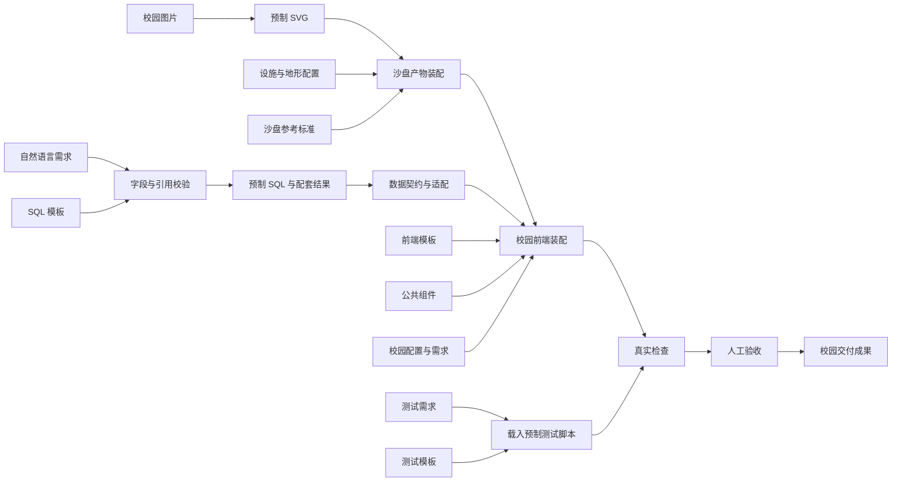

# 预制AI工作流脚本与校园前端计划

版本：2026-10-09 · 已按需求访谈实施。软件验证结果见配套运行说明；实际设备和两轮真人计时排练仍待完成。

排练依据：[新版路演与实操展示安排](../新版路演与实操展示安排.md)。软件交付位于 `zhixing-campus`；操作入口与恢复说明见 [校园演示运行与排练记录](../校园演示运行与排练记录.md)。

## 1. 目标、边界与现状

目标：以一条固定校园需求，演示“结构化输入 → 模板与公共组件复用 → 预制产物应用 → 真实检查 → 人工交付验收”。景区作为既有成品展示，校园承担制作和验收。

演示载体是纯节点画布：固定拓扑、手动推进、点击节点临时展开详情。独立端口打开校园成果，不使用 iframe、常驻结果面板或聊天生成界面。

### 1.1 执行边界

| 内容 | 本次准备方式 | 现场能够证明什么 |
| --- | --- | --- |
| 图片到 SVG、AI 产物生成 | 赛前准备输入输出，节点加载固定产物 | 说明结构化步骤及产物关系，不证明现场 AI 转换能力 |
| SQL | 预制文本与配套结果 | 展示字段与模板适配，不证明 SQL 已执行 |
| 校园配置与工单页面 | 加载真实可操作的演示阶段 | 验证模板应用后的页面变化与业务行为 |
| 输入与数据检查 | 浏览器中运行实际校验函数 | 验证当前输入和产物是否满足约束 |
| 业务状态检查 | 对隔离副本调用校园真实业务函数 | 验证领取、完成及其前置条件 |
| 人工验收 | 在后勤页面实际操作，操作者登记证据 | 验证可见页面与操作闭环 |

不建设真实 AI 调用、通用工作流引擎、业务后端、数据库、跨端业务同步或跨机协作。工作台的阶段控制只是这次固定演示的脚本播放器与检查入口。

### 1.2 开发前核实的基线（保留作对照）

- `zhixing-campus` 已有五端纯前端，公共沙盘为 5500，后勤端为 5503，组件预览为 5505；当前没有 5506 工作台。
- `scenario/config.ts` 提供场景配置；`packages/domain` 提供无网络依赖的业务函数；`packages/experience` 承载桌面页面。
- 现有 `createState` 深拷贝种子。各端独立，刷新恢复样例，无持久化或跨端同步。
- `claim` 将待处理改为处理中并设置处理人；`complete` 会拦截未领取和空处理结果，成功后改为已完成。真实检查应复用这些函数。
- 现有记录类型没有 `facilityId`、`buildingId`。不能把样例中编号的对应关系当作已有数据关联能力，需在演示契约中补充。
- 校园模型已经可用，但图片→SVG→模型并非已有生成管线。前置阶段使用预制材料，最终加载现有模型，不追加三维模型逐层生成改造。
- 现有 Vitest、Playwright、类型检查与构建命令可用于开发验收；本次文档工作未重新运行这些程序检查。

## 2. 阶段、角色、端口与素材

### 2.1 与排练稿共用的阶段表

| 阶段 ID | 时间 | 页面 | 主责 | 阶段交付 |
| --- | --- | --- | --- | --- |
| overview | 10:00–13:00 | 第 9 页 | 1 号 | 总流程、C01、验收标准 |
| map | 13:00–22:00 | 第 10 页 | 1 号 | 沙盘产物及 5500 页面 |
| sql | 22:00–30:00 | 第 10 页 | 3 号 | 字段契约、SQL、配套结果 |
| frontend | 30:00–40:00 | 第 10 页 | 2 号 | 校园配置及 5503 工单页面 |
| test | 40:00–49:00 | 第 10 页 | 4 号 | 真实检查报告与人工清单 |
| acceptance | 49:00–52:00 | 第 10 页 | 4 号操作，1 号串讲 | 单端业务闭环及最终成果展示 |

全场仍为 55 分钟内容＋5 分钟机动，其他页面纯讲共 13 分钟。实现时不按演讲时间设置自动计时播放。

### 2.2 运行入口

| 地址 | 职责 | 准备要求 |
| --- | --- | --- |
| `http://localhost:5506/` | 新工作台 | 独立 Vue 应用，纯节点画布 |
| `http://localhost:5500/` | 校园沙盘 | 接收校园沙盘演示阶段，保留已有交互 |
| `http://localhost:5503/` | 后勤工单 | 支持通用模板与校园成果两个阶段 |

统一使用 `localhost`，不在同场混用 `127.0.0.1`。不同端口是不同源，不能依靠 localStorage 或 BroadcastChannel 直接跨端同步。

### 2.3 素材清单与来源状态

以下编号在 `packages/demo/assets` 和 `packages/demo/src/materials.ts` 中统一维护。C01 为唯一案例源，M01/M02/M03 按模型布局生成，其他材料由同包模块组织。文本使用 UTF-8，图像本地提供，字体使用系统字体。

| 编号 | 素材／产物 | 格式与内容 | 准备方式／负责人 |
| --- | --- | --- | --- |
| C01 | 固定案例清单 | JSON：案例、楼宇、设施、工单、初始状态、处理结果、版本 | 从现有样例整理，3 号维护，四人共用 |
| M01 | 校园原始地图 | PNG：与最终校园布局一致，标注明理楼 | 1 号准备示意地图，不冒称真实测绘资料 |
| M02 | SVG 产物 | SVG：道路、区域、建筑 ID，可放大查看 | 1 号预制，与 M01/M03 对齐 |
| M03 | 设施与地形配置 | JSON：B1、F4、相对坐标与布局参数 | 1 号从既有校园布局整理，注明模型相对坐标 |
| M04 | 沙盘参考标准 | JSON/文本：模型样式、坐标约定、设施映射要求 | 1 号准备 |
| M05 | 沙盘阶段清单 | JSON：目标模型、视图、定位对象、产物版本 | 复用现有模型，1 号准备阶段参数 |
| S01 | 校园需求 | TXT：明理楼投影报修、按设施查看、领取处理、结果留痕 | 3 号准备 |
| S02 | SQL 模板与字段契约 | SQL＋JSON：固定结构、替换参数、字段映射 | 3 号准备 |
| S03 | 错误引用输入 | JSON：T1 的 facilityId 为 F404 | 3 号预制，仅用于唯一异常 |
| S04 | 修正引用输入 | JSON：同一 T1 的 facilityId 改为 F4 | 3 号预制，其余内容与 S03 相同 |
| S05 | SQL 产物 | SQL：针对 C01 的查询文本 | 3 号预制，明确标注未执行 |
| S06 | 配套结果 | JSON：SQL 展示对应的样例行 | 3 号预制，与 C01/F04 使用同一来源 |
| F01 | 通用前端起点 | 配置：通用标题、工单结构与待配置说明 | 2 号准备，不使用其他项目成品冒充空白起点 |
| F02 | 公共组件清单 | JSON＋精简源码片段：筛选、列表、详情、状态操作 | 从现有组件提取，2 号维护 |
| F03 | 校园配置 | JSON：校园名称、设施列表、显示字段、主题 | 2 号准备 |
| F04 | 前端数据适配产物 | TS/JSON：S06 到页面记录的字段映射与关联 | 2、3 号核对 |
| F05 | 校园页面阶段清单 | JSON：campus-ready 阶段与版本 | 2 号准备，打开真实页面 |
| T01 | 测试需求清单 | JSON：检查编号、输入、期望、类型 | 4 号准备 |
| T02 | 测试模板与用例 | TS：参数化数据检查、业务函数断言 | 4 号编写可实际执行的脚本 |
| T03 | 检查报告 | JSON：本轮真实运行结果、错误、素材版本 | 运行时生成，不预填通过 |
| T04 | 人工验收清单 | JSON：待核验／通过／失败与观察证据 | 4 号实际操作后登记 |

恢复用成果图、完成态页面另标为“预制完成态”，不得替代 T03 的真实结果。

## 3. 节点画布与交互脚本

### 3.1 画布布局

默认总图呈现沙盘、SQL、前端、测试四个分组与交付终点，节点名称对应原流程图的概念。空间产物与数据产物汇入前端，前端产物进入测试，自动检查后进入人工验收。



画布支持平移、缩放、适配全图与聚焦当前分组。分组位置固定，不提供新增节点、编辑连线、拖拽改拓扑或任意自然语言输入。角落只保留全图、阶段导航、复位等必要控件，不常驻输入输出侧栏。

工作台采用浅色专业工作流风格，以 Vue＋SVG 绘制固定画布。“定位下一步”只移动画布，不执行动作。点击节点打开临时右侧抽屉，内容按节点类型提供输入、规则、模板片段、产物、检查结果。一次只打开一个详情，支持关闭与 Esc；代码字体可放大。大屏优先展示业务名称与 5—12 行关键片段，完整素材可展开查看。

### 3.2 节点执行语义

| 状态 | 含义 | 后继行为 |
| --- | --- | --- |
| 未开始 | 尚未加载本阶段材料 | 等待操作员进入 |
| 可执行 | 前置产物已具备 | 启用当前动作 |
| 处理中 | 正在加载产物或执行检查 | 防止重复点击，不自动进入下一阶段 |
| 已产出 | 固定产物已加载 | 可查看；有实际页面应用时继续等待应用反馈 |
| 已通过 | 真实校验或指定验收已完成 | 解锁对应后继动作 |
| 已拦截／失败 | 输入不合法或实际运行失败 | 展示原因，后继保持锁定 |

预制产物加载可使用不超过 2 秒的状态动画；真实检查按实际耗时结束。不得以定时器直接将真实检查写为通过。所有解释停留由操作员控制。

错误输入被修正时，原失败记录保留为本轮历史，新输入重新检查。改变上游输入后，依赖它的检查结果标为待重跑，不能沿用旧的绿色状态。

### 3.3 固定动作序列

| 链 | 操作顺序 | 推进条件／页面切换 |
| --- | --- | --- |
| map | 查看 M01 → 加载 M02 → 查看 M03/M04 → 装配 M05 | 点击“查看校园沙盘”，打开 5500，返回画布交接 |
| sql | 查看 S01/S02 → 载入 S03 → 检查并拦截 → 载入 S04 → 复查 → 展示 S05/S06 | 引用检查通过后才允许向前端交付 |
| frontend | 查看 F01 并打开模板阶段 → 查看 F02/F03/F04 → 应用 F05 | 5503 实际加载校园阶段后记录应用成功，展示筛选与详情 |
| test | 查看 T01/T02 → 运行真实检查 → 查看 T03 → 按 T04 人工核对 | 自动结果真实记录，人工未做的项目保持待核验 |
| acceptance | 领取 T1 → 空结果拦截 → 填结果并完成 → 登记人工证据 → 回 5500 | 只有实际操作成功才登记通过 |

“接口”节点显示 F04 字段契约与适配，不显示虚构 HTTP 请求或数据库执行日志。预制日志描述正在加载的材料与产物，不伪造模型调用记录。

## 4. 数据契约、校园页面与端口衔接

### 4.1 单一案例来源

以 C01 为唯一案例来源，S06 与 F04 从同一份案例数据组织，避免两人分别维护而发生漂移。演示契约至少包含：

| 对象 | 必须字段与本例值 |
| --- | --- |
| 案例 | caseId、version；固定 caseId 为 `campus-projector-repair` |
| 楼宇 | id=`B1`、title=明理楼 |
| 设施 | id=`F4`、buildingId=`B1`、title=明理楼投影设备、location=明理楼 302 |
| 工单 | id=`T1`、facilityId=`F4`、title=明理楼投影画面偏色、status=待处理、description、location、owner、result |

`owner` 沿用当前后勤端处理人的含义，不增加学生提交或跨端身份场景。数据适配使用扩展的演示类型或关联表承载 facilityId/buildingId，不要求修改所有业务端的基础类型。

SQL 模板使用固定逻辑表名 `buildings`、`facilities`、`work_orders`，通过工单设施编号和设施楼宇编号关联，展示 `work_order_id`、`facility_id`、`building_id`、`facility_name`、`location`、`status` 等字段。前端适配显式将这些字段映射到演示对象。此处定义的是展示契约，不建设真实表。

引用校验至少检查：编号非空且唯一、T1 引用设施存在、设施引用楼宇存在、必要字段齐全、初始状态有效。唯一错误素材只将 facilityId 改为 F404；修正后必须仍是同一张 T1。

### 4.2 后勤端阶段

新增仅在演示参数启用时生效的模式，默认访问原端口继续现有行为。

- `template`：显示通用标题、可识别的工单页结构和待配置说明；不显示校园成品或可操作的 T1。用于 F1 的应用前对照。
- `campus-ready`：应用 F03/F04/F05，显示知行校园、设施筛选和 T1；具备详情、领取、填写处理结果、完成记录。
- `campus-map`：5500 加载已有校园模型、默认学习视图，能够定位 B1/F4；不另造分层三维模型。

后勤演示保留原有全部导航，但仅加载 T1/F4/B1；巡检等无关模块显示空态，工单待办由 1 变为 0。本轮首次登录预填 `staff01 / 123456`，由操作员点击登录，身份显示“后勤人员”；同轮切换、刷新、工单重置保留身份，整场复位清除。仅身份按 run 写入 5503 标签页的 sessionStorage，业务状态不持久化。演示副本全部可访问集合使用角色或编号；普通校园入口不变。

后勤端增加基于 facilityId 的设施筛选与详情关联显示，复用现有列表、详情和 `claim`/`complete` 逻辑。完成状态与待办变化保持当前业务规则。沙盘初始设施状态保留原演示配置，工单完成不会自动修改沙盘。

### 4.3 跨端口只做阶段控制

采用 URL 选择演示阶段，例如：

```text
http://localhost:5500/?demo=1&stage=campus-map&run=<本轮编号>
http://localhost:5503/?demo=1&stage=template&run=<本轮编号>
http://localhost:5503/?demo=1&stage=campus-ready&run=<本轮编号>
```

工作台通过用户点击打开固定名称的成果标签页并保留窗口句柄。首次打开、从 template 应用到 campus-ready、明确复位时才导航；普通“查看已有成果”只聚焦标签页，避免重载丢失现场操作。

每个端口读取本地已有的对应阶段素材，独立创建内存状态。`run` 标识轮次，不是后端会话。非法阶段显示清晰错误，不静默跳到完成态。

为确认实际应用与复位，增加最小 `postMessage` 桥接：

- 子页面实际显示对应阶段后回报就绪；后勤需完成登录，沙盘需模型就绪；至少携带 caseId、素材版本、run、stage。
- 工作台只在收到匹配回报后记录页面应用成功。页面未就绪时保持“等待成果页”，允许重开。
- 工作台可向已打开页面发送复位指令，子页面重建对应阶段状态并确认完成。
- 校验发送方 origin、窗口 source、run 和 stage；只接受当前主机 5500/5503/5506 的约定消息。
- 不传输工单操作、用户身份或业务状态快照；不存在跨端业务同步。

### 4.4 重试与复位

- 当前阶段重置：清除本阶段状态及依赖它的后续检查，恢复固定输入；SQL 重置后重新从 S03 的错误输入开始。
- 后勤验收重置：将 5503 重建为 campus-ready、T1 待处理，清空人工验收记录，不改写已有失败历史。
- 整场复位：生成新的 run，清除工作台本轮状态与报告，将已打开的后勤端恢复 template、沙盘恢复初始演示视图；确认各页回报后方可开始下一轮。未打开的页面按首次打开流程处理。
- 工作台刷新按新轮次处理，不静默续用旧报告；提示操作员执行整场复位。成果页刷新按 URL 阶段重新加载，页面显著提示业务状态已恢复。
- 阶段直达仅用于排练与故障恢复，固定预载所需材料；缺失的检查标为未执行，不伪造前序通过状态。正式流程按顺序推进。

## 5. 真实检查与人工验收

### 5.1 运行方式

T02 在工作台浏览器内执行，导入校园真实业务函数，对每次新建的 C01 副本运行。每个检查独立准备状态，不读写 5503 的现场工单，不需要新增后端或从网页启动 shell。

检查断言出错时捕获实际异常并记录，不能吞掉错误后返回通过。T03 每轮记录 caseId、素材版本、run、执行时间、检查 ID、类别、实际结果、期望和错误说明。支持查看和下载本地 JSON 报告。

这些检查覆盖数据与业务函数。UI 自动化属于开发阶段的 Playwright 验收；现场实际页面使用 T04 人工核验，报告不把函数检查写成“浏览器自动化全部通过”。

### 5.2 固定自动检查清单

| ID | 类别 | 操作与断言 |
| --- | --- | --- |
| D01 | 数据 | C01 必要字段、编号唯一、初始状态符合契约 |
| D02 | 数据 | S03 的 F404 被同一引用校验函数拒绝，错误明确指向 T1 的设施引用 |
| D03 | 数据 | S04 的 T1→F4→B1 引用通过 |
| D04 | 数据 | S06 关键字段与 C01 一致，F04 适配后的编号、位置、状态一致 |
| D05 | 数据 | F03 的设施筛选项包含 F4，工单与设施关联可解析 |
| B01 | 业务 | 新建副本中 T1 待处理，直接 complete 返回“请先领取任务”且状态不变 |
| B02 | 业务 | claim(T1, 后勤人员) 后状态为处理中、owner 为后勤人员 |
| B03 | 业务 | 领取后的空白处理结果被 complete 拒绝，状态仍为处理中 |
| B04 | 业务 | 输入固定处理结果后完成，保存结果，待办指标相对初始减少 1 |
| B05 | 隔离 | 再建一份状态仍为待处理、无完成结果，原始 C01 未被上次检查修改 |

D02 是“预期拦截有效”的检查，通过不代表 S03 合法。报告必须同时写出被测输入的拒绝结果与该断言通过，避免解释混淆。S03/S04 使用与 SQL 阶段完全相同的校验实现。

### 5.3 人工清单

| ID | 时间段 | 实际页面证据 |
| --- | --- | --- |
| H01 | 沙盘段 | 明理楼可定位，设施详情对应 F4，缩放或旋转可操作 |
| H02 | 前端段 | 通用模板与校园成果存在明确变化，F4 可筛选，T1 详情可打开 |
| H03 | 测试段 | 自动检查后，现场 T1 仍是待处理，位置和设施一致 |
| H04 | 最终验收 | 领取后处理中；空结果被拦截；填写固定结果后已完成 |
| H05 | 最终验收 | 完成记录保留处理结果；回到沙盘仍可查看校园成果 |

T04 默认全部待核验。通过或失败均须填写观察说明，记录时间，并随本轮 JSON 导出；不上传截图。H01/H02 在对应段展示后由 4 号在测试段核对登记；H04/H05 完成前不得提前勾选。最终总览区分“自动检查通过”和“人工验收完成”，存在失败或待核验时不显示全项通过。

## 6. 开发拆分与交付顺序

### 6.1 代码组织

在 `zhixing-campus` 内提供独立 `apps/demo`，不占用已有组件预览端口 5505。新增演示包 `packages/demo`，集中保存阶段契约、C01 与预制产物、适配器、真实检查脚本；工作台和校园演示模式从同一包读取。

桌面端的演示模式在现有 `packages/experience/src/App.vue` 状态初始化附近接入，按参数选择模板或校园种子；尽量把桥接、复位和适配逻辑放到独立模块。现有非演示访问不受影响。

### 6.2 实现顺序与验收门槛

| 顺序 | 工作包 | 负责人建议 | 完成门槛 |
| --- | --- | --- | --- |
| 1 | C01、字段契约、全部素材编号与版本 | 3 号牵头，1/2/4 号核对 | 四条链共用同一组对象，S03/S04 仅设施引用不同 |
| 2 | 工作台壳、固定画布、详情、手动阶段控制 | 2 号 | 全图与聚焦可读，无固定侧栏，状态能被显式重置 |
| 3 | 沙盘预制材料与 5500 阶段入口 | 1 号 | 图片/SVG/设施映射与现有模型一致，可实际定位 |
| 4 | SQL 节点、真实引用检查、异常修正 | 3 号 | F404 阻断后继，修正后显示 SQL 与配套结果 |
| 5 | 后勤模板与校园阶段、筛选、适配与页面就绪反馈 | 2 号 | 页面确实变化，T1 可查看且保留至最终验收 |
| 6 | 真实检查、报告、人工登记与恢复入口 | 4 号 | 失败不伪装成功，检查状态与现场状态隔离 |
| 7 | 统一启动、离线素材、两轮排练 | 4 号检查，1 号计时 | 单屏可走完整场，恢复动作与两份文档一致 |

人员可协助开发，现场职责仍按排练稿执行。本表保留工作包划分；软件实现与实际四人排练分开验收。

### 6.3 启动与预演入口

`pnpm dev:demo` 启动工作台；`pnpm demo:start` 统一启动 5500、5503、5506 并在任一进程异常退出时给出错误、清理其余进程。这些命令不替换现有 `pnpm dev` 五端开发入口。

正式演示前运行 `pnpm demo:build` 构建并验证本地静态版，为这三个端口提供统一的 `pnpm demo:serve` 启动脚本；默认仅绑定本机，端口被占用时明确失败，不自动换端口。依赖安装、构建和浏览器准备在赛前完成，现场只启动服务。开发验收同时覆盖开发入口和正式静态入口。

提供阶段直达菜单、当前阶段重置与整场复位。恢复用成品图及完成态包含在本地素材中，并在界面明确标识。

## 7. 开发验收、现场设备与完成定义

### 7.1 开发验收

在 `zhixing-campus` 运行现有类型检查、单元测试、浏览器测试和构建。针对新增演示能力补充有行为意义的检查，不为本轮文档变更新增程序测试。

- 单元：D01—D05、B01—B05；阶段依赖失效；错误输入不可应用；真实报告保留失败；C01 不被检查修改。
- 浏览器：纯画布详情开关与缩放；S03 拦截及 S04 解锁；5503 从 template 到 campus-ready 的实际变化；新旧素材版本或 run 不匹配时不能错误确认应用成功。
- 浏览器：重复点击不会重复打开新标签页；普通查看成果不会重置工单；关闭后重开有清晰状态；超时未就绪能够重试。
- 浏览器：测试后现场 T1 仍待处理；完整工单验收；当前阶段复位与整场复位；非法阶段明确报错。
- 回归：不带演示参数时，原校园各端独立状态与刷新行为保持原样。
- 运行：静态版三端启动成功、端口冲突可诊断；断开外网仍可加载全部字体、图片、代码和模型。
- 视觉：先按 1920×1080、1366×768 两种浏览器视口检查，最终以实际大屏确认。当前节点、错误信息和关键代码片段可读，节点详情不溢出。

### 7.2 设备待核实清单

仅确认有两块大屏；以下由 1 号赛前核实并记录实际结果：主机由谁提供及配置、屏幕输入接口、能否作为电脑显示器、连接线与转接器、可用分辨率、扩展/复制显示方式、现场供电。计划不依赖触控、局域网或屏幕自带系统。

一台主机和一块可显示电脑画面的屏幕即可完成核心流程。第二屏可用时放景区成品；不可用时只在 PPT 第 6 页呈现景区。设备与平台的实体联动不列为已实现成果。

### 7.3 完成定义

软件交付包含：工作台、C01 与全部素材、可操作校园阶段、真实检查脚本与报告、统一启动和恢复入口、人工验收清单与两轮完整排练记录模板。真人排练由四位选手实际完成：两轮均从整场复位开始，正常内容在 55 分钟内完成。

所有报告分别标识预制产物、真实检查和人工记录。故障时先重试或复位，仍失败则明确切换到预制完成态继续说明，真实失败保留。景区、其他校园端、真实 AI 和数据库均不成为核心演示的外部依赖。
