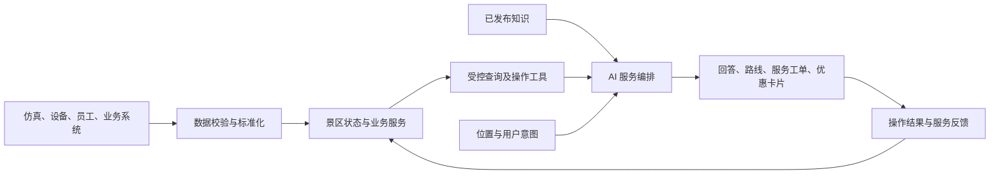

# AI 聊天深化开发评估报告

日期：2026-09-27。性质：基于当前仓库的需求分析与实施建议，尚未实施新业务，也未进行线上或真机验收。

## 1. 核心判断

建议把 AI 助手定位为“能查询现场状态、帮助安排游览、受理服务诉求，并在合适时提供优惠的景区服务入口”。方向可行，而且能把现有六端、运行数据和仿真能力串成有说服力的完整演示。

开发重点应从回答更丰富，转向答案有业务依据、操作有实际结果、服务有后续反馈。商业推荐服务于游客当下需求，不能改变安全判断、掩盖投诉或强迫绕路消费。

用户已确认：第一阶段优先完成竞赛演示闭环，使用现有仿真数据；推广采用对话中推荐和抵达时可关闭的小卡片。用户进一步确认：无现成优惠券系统，第一期只新增展示型领券中心，AI 推荐的优惠券点击后能展示二维码即可，不需要核销。建议数据接口允许后续接入真实来源。

## 2. 当前代码核查结果

| 能力 | 当前证据与实际边界 | 后续工作 |
| --- | --- | --- |
| 基础聊天 | `apps/server/src/services/qa.ts` 已有会话、历史消息、流式回答、重试、停止、限流和运行隔离 | 保留现有链路，扩展工具和卡片协议 |
| 景区状态进入 AI | `knowledge.ts` 根据问题与会话景点选资料，并加入景点开放、忙闲和道路关闭信息；`index.ts` 接入平台公开快照 | 已有动态状态基础，不应从零重建；补细粒度查询、时间语义和可追踪依据 |
| 模型工具调用 | `model.ts` 当前发送文本消息与资料，没有发现 tools/tool_calls 的执行循环 | 新增受控工具层、结果校验和错误处理 |
| 知识问答 | 当前问答主要读静态资料与状态快照；本条链路未见管理员已发布知识检索接入 | 统一已发布知识入口；内容量小时不必先引入向量数据库 |
| 位置上下文 | QA 页面支持 `poiId`，会话绑定景点；请求类型主要是问题文本和重试编号 | 会话景点不等于实时位置，需要新位置上下文及其来源、时间、可信度 |
| 优惠券 | 在本轮核查的服务端、手机端和契约中未检索到完整券业务实现 | 新增展示型领券中心、券详情二维码及 AI 券卡；不建设核销业务 |
| 客服处置 | 已有任务、前线终端、通知、公开消息举报及申诉能力 | 消息举报不是卫生投诉；游客服务工单与 AI 受理需新增或适配 |
| 后台菜单 | `apps/admin/src/router.ts` 将游客、员工、聊天、审核和知识放在“账号与互动” | 按用户要求拆开；这是低风险小改动 |

现有项目说明明确客流和设施遥测主要来自仿真。报告不将这些能力表述为真实设备已经接入，也不把设计文档中的计划当成已实现功能。

当前还有两个与新需求直接相关的细节：`contextFor()` 允许 `light` 忙闲值，却缺少对应中文标签；快照资料使用回答时的当前时间，不能替代原始观测时间。后续应一起修正，避免“状态未定义”和“旧数据看起来刚更新”。

## 3. 六项需求的产品设计

### 3.1 从聊天升级为可查询、可行动的助手

每次请求按“理解问题 → 识别景点或设施 → 查询必要数据 → 校验结果 → 回答并附操作卡片”执行。普通讲解不必调用实时工具，问客流、开放和排队时必须读取对应业务数据。

实时客流不建议不断写进知识库。知识库负责相对稳定的介绍、规则和服务说明；实时状态通过业务查询获取；投诉提交等动作通过明确的业务接口执行；本期券卡点击只需打开对应优惠详情及二维码。

第一批建议工具如下，名称为拟定方案，并非已有接口：

| 工具 | 用途 | 约束 |
| --- | --- | --- |
| `get_place_status` | 查指定景点、设施的开放、拥挤及排队状态 | 返回观测时间、来源、有效期；没有排队数据就不返回精确分钟数 |
| `find_nearby_services` | 查厕所、休息点、饮水、商店等 | 基于可走路网与开放状态，不只按直线距离 |
| `recommend_routes` | 比较可行的替代路线 | 后端校验封路、闭园、同行条件及预计步行时间 |
| `search_published_knowledge` | 查经营规则、景点资料和服务说明 | 只读已发布版本，不读取管理员草稿 |
| `list_eligible_coupons` | 查当前可展示且符合场景的公开优惠券 | 营业状态、适用条件、有效期和上下架状态由业务服务判断；本期不建个人领券资格体系 |
| `create_service_request` | 提交卫生、排队、设施等服务诉求 | 用户明确要求提交，或先确认简短摘要；请求幂等 |
| `get_service_request_status` | 查询自己的诉求进度 | 按用户权限隔离，不能跨用户查看 |

本期卡片按钮直接打开券详情和二维码，不要求独立领取接口或个人券资产。模型也不应直接决定补偿金额、修改券规则或访问数据库。

### 3.2 “前面人多不多”必须先解决指代问题

“前面”“这里”“刚才那个厕所”需要结合当前路线、最近一次扫码、位置及对话上下文解析。进入某个景点详情页不代表人真的在那里；扫码也可能来自保存的图片，因此位置来源应明确区分。

建议位置上下文包含：当前位置或选定点位、来源、定位时间、精度、当前路线和下一站。没有朝向或有效路线时，GPS 本身也不足以判断“前方”。不确定时只追问一个关键问题，例如“你指的是望岳台吗？”

例：游客问“前面的望岳台人多不多？”系统查询目标状态，再比较替代点位与路线。只有数据支持时，才回答“目前比较拥挤，可以先去松风林，稍后再来”，并展示查看路线按钮。步行分钟数由路线服务给出，排队分钟数由有效排队数据或明确标注的估计提供。

需要防止把所有人同时引向同一个冷门点：候选路线还要考虑接收区域容量，后续可对推荐人数设阈值；不能只看当前哪里人少。

### 3.3 后台账号与互动拆分

同意将游客管理、员工管理移入“系统”，与服务状态并列。第一步保留原页面和 URL，仅改变菜单归属，减少旧入口失效风险。

建议逐步形成以下结构，新增页面按实际阶段出现：

| 分类 | 页面 |
| --- | --- |
| 系统 | 游客管理、员工管理、服务状态；后续按需增加权限与审计 |
| 互动与服务 | 聊天管理、AI 言论审核、游客服务工单、AI 会话查询 |
| AI 配置 | 先迁入现有知识查看；后续补知识发布、数据与工具状态、服务策略 |
| 营销管理 | 优惠券展示配置、推荐策略；按需增加曝光和二维码查看统计 |

菜单分组不等于权限隔离。员工账号维护、私密会话查看和优惠券配置仍须服务端授权。公开言论审核与私聊客服是不同业务，正常投诉不能因不利于景区形象而被撤回。

### 3.4 公开优惠券与 AI 推荐

用户的核心设想是“人人本来都能领，AI 在需要时帮用户发现”。本期已确认以展示为主：领券中心和 AI 共用同一份券配置，展示相同优惠内容、门槛、有效期及二维码。

本期最小范围：公开领券中心、券详情或弹层、二维码展示、AI 推荐券卡，以及便于演示维护的券配置。每张券可关联门店或景点用于推荐。暂不增加独立商家管理系统、我的券、库存扣减、个人领取流水、核销接口及收银对接。

券配置至少包含：券 ID、标题、优惠内容、门槛、适用门店、有效期、展示状态、二维码内容或图片；按需补充使用说明及关联点位。二维码默认编码项目内的演示券详情链接，不包含个人身份或真实核销凭证，并标明演示用途。打开时检查上下架和有效期，失效券展示明确状态，不继续推荐。按钮优先使用“查看优惠 / 展示二维码”，避免把打开二维码说成已发放真实权益。

适宜触发：用户主动找吃喝优惠；询问休息处；在获得路线建议后表示想等一会；主动抱怨排队并愿意换个安排。仅路过商店不应反复弹广告。

话术示例：“等得久确实影响心情。我先帮你看看能不能少排一会。如果你想休息，附近茶饮店有一张公开可领的优惠券，可以顺手看看。”具体门店、距离和券内容必须来自查询结果。

不建议说“我特地补偿你一张券”，除非确实存在独立补偿政策。公开优惠可以带来被照顾的感受，但不能依靠把公开权益包装成专属赔偿来制造这种感受。

如果将来需要真正补偿，应另设权限、额度、审批及发放台账，与公开券推荐分开。

### 3.5 安抚型客服必须有处理闭环

建议顺序为“理解不便 → 给出能用的替代方案 → 按意愿提交问题 → 返回真实进度 → 适合时再推荐权益”。用户抱怨并不自动等于同意留下正式投诉记录。

例如“厕所太脏了”：简短回应感受，识别具体厕所，查询附近可用设施，询问或承接用户的提交指令，生成卫生工单并流转前线，完成后向游客反馈。不要把投诉原文直接广播给所有员工。

建议状态为：待受理、已受理、处理中、待核验、已完成、已关闭；只有明确接入相应处理环节才展示该状态。员工点击完成不等于游客满意，用户应能继续反馈。用户报告的“脏”先保留为待核查信息，不能直接变成面向所有游客的已证实事实。

涉及受伤、走失、明显危险时，先提供已核实的求助入口和必要指引，不展示营销推荐。普通卫生投诉也不必每次跟一张奶茶券，以免显得敷衍。

自动合并同设施的重复问题可以减少工作量，但不同游客应保留各自的回执与查询权限。投诉优先级根据问题影响和紧急程度确定，不能因领取了优惠券就降低处理优先级或自动结案。

### 3.6 数据与 AI 的扩展价值

| 场景 | 所需数据 | 可以形成的服务 | 优先级 |
| --- | --- | --- | --- |
| 动态避拥堵 | 区域客流、开放状态、路网 | 解释拥挤程度、提供替代游览顺序 | 第一阶段 |
| 厕所及休息服务 | 设施可用性、位置、无障碍信息 | 就近找可用设施，按同行条件筛选 | 第一阶段 |
| 投诉回流 | 诉求位置、类型、工单进度 | 游客报告—员工处理—游客收到结果 | 第一阶段 |
| 等待期间消费 | 等待情况、商家营业、距离、券 | 在用户愿意休息时推荐合适优惠 | 第二阶段 |
| 闭园与返程 | 时间、道路、交通服务时刻 | 提醒返程、规避已关闭路线 | 第二阶段 |
| 活动游览 | 活动场地、开始时间、容量 | 推荐顺路且能赶上的活动 | 第二阶段 |
| 个性化行程 | 用户明确提供的时长、同行人、偏好 | 老人少台阶、亲子多休息、摄影路线 | 第二阶段 |
| 天气响应 | 可靠天气或景区预警、避雨设施 | 推荐避雨或更稳妥路线 | 有数据后 |
| 运营分析 | 聚合问题、推荐、投诉与处置数据 | 识别高频痛点、缺失设施和知识盲区 | 后续 |

游客反馈可以作为巡检线索，与设备状态相互验证；不能将未经验证的投诉、评论或商家文案自动提升为景区官方事实。跨用户运营分析默认使用汇总与脱敏数据，不为了推券建立长期负面情绪画像。

## 4. 商业推荐的平衡规则

以解决问题为主要目标，安全和服务优先于商业转化。先过滤不适宜场景、关闭或不可达商家、下架或过期优惠券，再按需求匹配、实际绕行成本、门店拥挤程度排序。商业合作仅可在合格候选中影响排序，不得覆盖安全限制。

建议初始规则，均可在后台配置并通过演示反馈调整：

- 普通一轮回答最多附一张商业卡片，不占满对话主体。
- 非用户主动索券的商业推荐，每位游客每次游园最多两次，两次间隔至少三十分钟；统一计算对话与抵达卡片，避免多入口叠加。
- 同一张券本次游园不反复推荐；用户仍可从领券中心主动再次打开二维码，不需要建设“我的券”。
- 关闭一次后本次会话停止主动推荐；选择“不再推荐优惠”后按账号偏好持续生效，领券中心仍可主动访问。
- 默认不做后台和站外推送；位置触发先在前台实现，用户可关闭。即使停用营销，安全提醒和用户请求的工单通知仍按各自设置运行。
- 明确展示门槛和有效期；有商业合作影响排序时使用清晰的“优惠推荐/合作商家”等标识。
- 提供免费休息、饮水、替代游览等非消费选项，不把“解决等待”全部导向消费。

“抵达”需要防定位漂移与重复进出触发。演示期可用扫码、明确的到达按钮或仿真事件验证；后续真实定位再引入停留判定、精度门槛与冷却。不要把 H5 或小程序后台持续定位、站外通知当作默认已具备能力。

评估不能只看优惠卡点击率。还应看问题解决率、投诉处理时间、推荐关闭率、拒绝推荐后再次打扰次数，以及是否把人引向新的拥堵点。本期可记录曝光、详情打开及二维码展示，不统计未接入的领取、核销或成交转化，也不能把打开二维码认定为真实消费。

## 5. 数据及技术实施建议

### 5.1 数据分层

建议沿用统一后端、PostgreSQL 和现有事件通知，先在内部新增明确的查询与策略模块，无需立刻拆成多个微服务。

数据输入需要包含景点或设施 ID、指标、单位、观测时间、接收时间、来源、质量状态、版本；演示还应携带 `runId` 和业务时间。位置单独记录来源和精度。空间实体使用统一 ID，避免设备、商家和地图中的同一地点无法关联。

仿真回放、当前运行和真实观测必须隔离。数据新鲜度使用对应业务时钟计算，工具超时使用实际耗时计算；切换演示运行后，旧会话结果和缓存不能串入新运行。

数据采集适配器负责设备推送或拉取、格式校验、重复事件处理、异常值识别和断线状态。人工关闭、安全管控应作为路线的强约束；游客反馈作为待核查线索。来源冲突需要保留双方记录并按配置规则处理，不能让模型自由挑选有利数据。

### 5.2 实时性与降级

实时的含义是“用有时间标记、仍有效的最新可用数据回答”，不代表模型持续掌握现场。不同指标设置不同有效期；例如客流可先试一至两分钟刷新、超过五分钟视为过期，但须依据真实数据源调整，这只是初始建议。

工具返回 `observedAt`、有效期、来源类型和可用状态。缺失、过期、冲突、查询失败分别处理：可以展示上次更新时间，给保守替代建议；不能把“未知”当作“人少”，也不能把低人流直接换算成精确等待时间。

动态数据读取业务服务或短期缓存；稳定知识按发布版本检索。多项独立查询可以并行，限制工具轮次与总耗时，超时后保留已获得的可靠信息。模型不可用时仍保留状态卡、路线入口和领券中心。

### 5.3 工具、消息和权限

第一期工具白名单控制在约七个，参数必须按结构校验，工具只返回用户有权看到的必要字段。用户身份、权限和运行编号由服务端决定，不能由模型生成的参数覆盖。

读操作自动执行；提交诉求等写操作依据用户明确意图执行并防重复。工具成功后才能说“已提交”，失败时保留重试入口。工具输入中的商家描述、知识文本及投诉原文都作为资料，不作为授权指令。

扩展现有流式协议，区分文本、查询状态、路线卡、券卡、工单回执及失败状态。卡片由服务端结构化结果生成，页面不能从模型自然语言中猜测券 ID、金额或工单编号。取消、重试及断线恢复需同时恢复卡片与真实业务状态。

日志记录本次回答使用的数据版本、工具调用、推荐原因、被过滤原因与耗时，便于复盘。生产日志和管理员会话查询要限制访问并设保留期限，不默认采集长期轨迹或无限期保存原始对话。

## 6. 建议实施顺序与工作量

以下为熟悉现有项目、全职开发的一名工程师的粗估人日，包含常规联调，不是承诺工期；真实硬件、真实商家和微信审核不在估算内。范围对齐后应再细拆。

| 阶段 | 交付 | 粗估 |
| --- | --- | --- |
| A：查询与路线 | 工具编排、状态与知识接入、位置上下文、替代路线卡、菜单拆分 | 5–8 人日 |
| B：客服闭环 | 服务诉求、确认与回执、对接前线任务、查询及通知 | 4–7 人日 |
| C：优惠展示 | 共用券配置、领券中心、详情二维码、AI 券卡及频控 | 2–4 人日 |
| D：主动服务与验收 | 前台抵达事件、退订策略、统计、异常回归和六端联动演示 | 4–7 人日 |

建议按 A → B → C → D 推进，总体暂估 15–26 人日；相比原完整领券与核销方案，优惠部分已缩减。真实地图距离映射、路网适配和现有任务生命周期的复用程度是主要不确定项。仅移动菜单通常为半天量级，计入 A 阶段。

第一轮评审应交付可点击的三条路径：问拥堵并换路线、投诉并查看处理进度、查看公开优惠并展示二维码。不要第一期同时引入复杂画像、动态定价、向量数据库、站外营销和自主补偿，会明显扩大调试范围。

## 7. 验收基线

1. 在演示端改变客流后，AI 下一次查询能使用新状态，且依据与大屏同一运行、同一口径。
2. 未提供有效位置时，“前方”会得到必要澄清；不凭会话景点冒充实时定位。
3. 道路关闭、景点关闭或营业结束后，替代路线不会继续推荐；没有路径结果不编造方向和距离。
4. 客流数据过期或源断开时，回答说明时效，不输出确定的当前拥挤程度或伪造排队分钟数。
5. 用户投诉可生成一条真实回执，员工处理后用户能查到状态；重试不会重复建单。
6. 优惠券在领券中心与 AI 卡片中的内容、门槛、有效期和二维码一致；二维码可解码至对应演示详情，过期或下架券不继续推荐，不显示虚构的领取或核销成功。
7. 拒绝营销后不再主动推券；同一券、多轮对话、抵达事件的去重和频控一致。
8. 危险求助不夹带营销；普通差评不被当成违规；投诉不会因推荐或领取券而自动结束。
9. 普通游客不能查别人会话和工单；恶意输入不能改变工具权限或读取草稿知识。
10. 模型失败、工具超时、切换运行、取消生成和断线重试，都不会出现假成功、串数据或重复业务动作。

建议准备不少于三十条固定评测问题，覆盖正常、含糊、数据过期、封路、恶意输入、重复提交和拒绝推广。路线合法性、权限、券展示有效性等硬条件用接口与规则测试，话术自然度和安抚效果通过人工评阅补充。

## 8. 需要进一步对齐

1. 已确认：第一阶段为竞赛演示闭环，使用现有仿真数据。
2. 已确认：对话中推荐，抵达时仅出现可关闭的小卡片。
3. 已确认：没有现成系统；只做展示型领券中心和 AI 券卡，能展示二维码即可，不做核销。
4. 是否认可将卫生、排队等投诉接入现有前线终端；由谁受理，是否需要承诺处理时限？
5. “公开券推荐”与“真正补偿”是否明确分开，当前阶段是否只做前者？

前三项范围已确认；后两项建议默认采用“接入现有前线处置、不承诺未配置的时限、只做公开券推荐”，由用户修订。

## 9. 核查依据

- [项目说明](../README.md)
- [QA 服务](../apps/server/src/services/qa.ts)
- [当前知识与快照组装](../apps/server/src/knowledge.ts)
- [模型请求](../apps/server/src/model.ts)
- [景区状态服务](../apps/server/src/services/scenic-state.ts)
- [平台 HTTP 接口](../apps/server/src/platform/http.ts)
- [手机端问答页面](../apps/mobile/src/pages/qa/index.vue)
- [QA 接口类型](../packages/contracts/src/mobile-qa.ts)
- [后台菜单](../apps/admin/src/router.ts)
- [原 AI 需求规格](景区AI后端能力需求文档-V1.0.md)

本次只做静态代码和文档分析，不对当前模型效果、线上部署状态、真实客流准确率或真机定位能力作验证结论。
